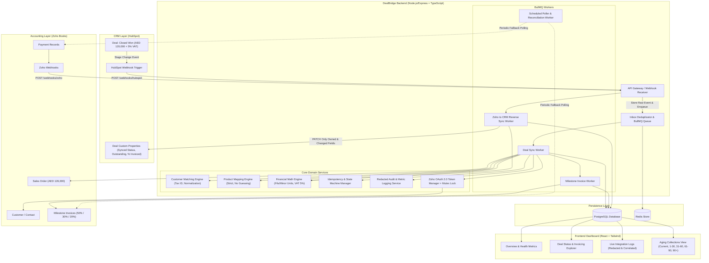

# DealBridge: CRM & Zoho Books Integration Master Implementation Plan

> **Role & Assignment Context:** Full-Stack Developer Intern Assignment for Complyance  
> **Core Objective:** Build a production-grade, two-way integration between HubSpot CRM and Zoho Books with guaranteed idempotency, exact financial math, resilient error handling, background queues, an audit log, collections aging analysis, and a modern monitoring dashboard.

---

## 1. Architectural Blueprint & Technical Stack

### 1.1 Selected Technology Stack

| Layer | Technology | Rationale & Justification |
| :--- | :--- | :--- |
| **Backend Framework** | **Node.js + Express + TypeScript** | Strict type safety for financial data models, robust ecosystem for integration services, clean controller/service architecture. |
| **Database & ORM** | **PostgreSQL + Prisma ORM** | ACID transactions, strict schema constraints, unique idempotency keys, robust relational querying for multi-deal payment allocations. |
| **Queue & Background Jobs** | **Redis + BullMQ** | Decouples CRM webhooks from Zoho processing; supports exponential backoff, rate limit delays, delayed milestone jobs, and crash recovery. |
| **Frontend Dashboard** | **React (Vite) + Tailwind CSS + Lucide Icons** | High-performance dashboard displaying real-time integration logs, deal financial statuses, and customer collections aging views. |
| **CRM** | **HubSpot CRM (Developer Sandbox)** | Real CRM platform with webhooks, custom object properties, deal pipelines, and rich API support. |
| **Accounting / ERP** | **Zoho Books (Trial Org - UAE Region)** | Standardized accounting system supporting AED currency, 5% UAE VAT, Sales Orders, Milestone Invoices, and Payments. |
| **Testing Engine** | **Vitest / Jest + Supertest** | Fast unit and integration testing for currency math, customer matching algorithms, and duplicate delivery deduplication. |

---

### 1.2 System Architecture Diagram



---

## 2. Comprehensive Phased Implementation Roadmap

We break down development into **11 sequential, incremental phases**. Each phase ends with a specific verification step and git commit.

```mermaid
flowchart LR
    P0[Phase 0: Repo & Tooling] --> P1[Phase 1: Accounts & Sandbox]
    P1 --> P2[Phase 2: Database Schema]
    P2 --> P3[Phase 3: OAuth & API Clients]
    P3 --> P4[Phase 4: CRM to Zoho Sync]
    P4 --> P5[Phase 5: Milestone Invoicing]
    P5 --> P6[Phase 6: Zoho to CRM Reverse Sync]
    P6 --> P7[Phase 7: Reliability & Idempotency]
    P7 --> P8[Phase 8: Automated Test Suite]
    P8 --> P9[Phase 9: React Dashboard & Collections]
    P9 --> P10[Phase 10: 15/20 Dataset & Audit Benchmark]
    P10 --> P11[Phase 11: Docs & Final Submission Pack]
```



---

### Phase 0: Project Setup, Tooling & Git Hygiene
- **Goal:** Set up a clean monorepo or standard multi-tier project structure with TypeScript, ESLint, Prettier, and Git configuration.
- **Tasks:**
  1. Initialize Git repository and set standard branch protection (`main` / `develop`).
  2. Create standard folder layout:
     ```
     DealBridge/
     ├── backend/
     │   ├── src/
     │   │   ├── config/
     │   │   ├── controllers/
     │   │   ├── services/
     │   │   │   ├── hubspot/
     │   │   │   ├── zoho/
     │   │   │   ├── sync/
     │   │   │   └── financial/
     │   │   ├── queues/
     │   │   ├── workers/
     │   │   ├── middleware/
     │   │   └── models/
     │   ├── prisma/
     │   └── tests/
     ├── frontend/
     │   ├── src/
     │   │   ├── components/
     │   │   ├── pages/
     │   │   ├── services/
     │   │   └── types/
     ├── context/
     │   └── (assignment files, architectural plans)
     ├── docs/
     │   ├── architecture.md
     │   ├── sequence-diagram.md
     │   ├── field-mapping.md
     │   └── scenario-answers.md
     ├── docker-compose.yml
     └── README.md
     ```
  3. Configure `.gitignore` to prevent any secrets (`.env`, `tokens.json`, etc.) from being committed.
  4. Set up `docker-compose.yml` for local PostgreSQL and Redis.
- **Git Commit Milestone:** `chore: initialize repository structure, docker-compose, and tooling configurations`

---

### Phase 1: External Services Configuration & Sandbox Credentials
- **Goal:** Configure HubSpot Developer Account and Zoho Books Trial Organization with exact regional and financial parameters.
- **Tasks:**
  1. **HubSpot Setup:**
     - Create HubSpot App Developer Account / Test Portal.
     - Define Custom Deal Properties:
       - `zoho_sales_order_id` (Single-line text)
       - `zoho_sales_order_total` (Number / Currency - AED)
       - `zoho_total_invoiced` (Number / Currency - AED)
       - `zoho_percentage_invoiced` (Number / Percentage)
       - `zoho_total_collected` (Number / Currency - AED)
       - `zoho_percentage_collected` (Number / Percentage)
       - `zoho_amount_unpaid` (Number / Currency - AED)
       - `zoho_amount_not_invoiced` (Number / Currency - AED)
       - `zoho_next_due_date` (Date)
       - `zoho_is_overdue` (Boolean / Dropdown: Yes/No)
       - `zoho_integration_status` (Dropdown: Synced, Pending, Error, Needs Review)
       - `zoho_last_sync_time` (Date/Time)
  2. **Zoho Books Setup:**
     - Create Zoho Books Trial Organization in UAE region (tax compliant).
     - Set base currency to **AED**.
     - Configure **5% UAE VAT** tax rate.
     - Create standard item: `Enterprise Software Implementation` (Tax: 5% VAT).
     - Generate Self-Client OAuth credentials (`client_id`, `client_secret`, initial `refresh_token`, and `organization_id`).
  3. Create `.env.example` documenting all configuration keys.
- **Git Commit Milestone:** `docs: configure external CRM and ERP sandbox environments and document variables in .env.example`

---

### Phase 2: PostgreSQL Database & Schema Design
- **Goal:** Design an enterprise-grade relational database schema adhering strictly to relational integrity, payment allocations, idempotency tracking, and audit logging.
- **Schema Entities:**
  1. `customers`: Maps HubSpot `company_id` to Zoho `contact_id`. Stores tax TRN, normalized domain, sync status.
  2. `deals`: Stores HubSpot `deal_id`, deal stage, currency, base amount, VAT amount, total amount, sync status.
  3. `products`: Strict mapping table between CRM product codes/names and Zoho `item_id`.
  4. `sales_orders`: Maps CRM deal to Zoho `sales_order_id`, order number, total value, tax total.
  5. `invoices`: Maps milestone invoices (milestone number, Zoho `invoice_id`, invoice number, status: DRAFT, SENT, PAID, VOID, amount, tax, due date).
  6. `payments`: Tracks Zoho payment records (`payment_id`, date, total payment amount, payment method).
  7. `payment_allocations`: **Key design point!** Links a single payment to specific invoice IDs with allocated amount.
  8. `milestones`: Tracks the 3 deal milestones (1: Signing 50%, 2: Go-Live 30%, 3: 90 Days 20%), status (PENDING, TRIGGERED, INVOICED).
  9. `integration_operations`: Idempotency registry storing `idempotency_key`, `operation_type`, `deal_id`, `status`, `response_payload`, timestamps.
  10. `webhook_events`: Stores raw inbound webhook payloads with hash for deduplication.
  11. `integration_logs`: Detailed API call telemetry (system: HUBSPOT/ZOHO, endpoint, method, status_code, duration_ms, request_body_masked, response_body_masked, deal_id, correlation_id).
- **Git Commit Milestone:** `feat(db): implement prisma relational schema, migrations, and seed scripts`

---

### Phase 3: Resilient API Clients & Zoho OAuth Mutex
- **Goal:** Build modular, robust HTTP clients for HubSpot and Zoho Books featuring auto token refreshing, concurrency mutex locks, and request telemetry.
- **Key Modules:**
  1. `ZohoTokenManager`:
     - Checks token expiry timestamps.
     - Implements an async lock (mutex) so concurrent worker jobs do not fire simultaneous refresh requests.
     - Securely stores active access tokens in Redis/Memory with safe TTL.
  2. `ZohoApiClient`:
     - Built-in rate-limit detector (HTTP 429 backoff reading `Retry-After`).
     - Automatic retry on network hiccups and 5xx errors with exponential jitter.
     - Request / Response interceptor that logs every single call to `integration_logs` (with token/secret redaction).
     - Global API call counter tracking total requests per operation.
  3. `HubSpotApiClient`:
     - Deals API (read deal, read company, patch deal properties).
     - Webhook signature validator (validating `X-HubSpot-Signature-v3`).
- **Git Commit Milestone:** `feat(api): implement resilient zoho and hubspot api clients with oauth token manager and telemetry`

---

### Phase 4: CRM → Zoho Books Core Integration Flow
- **Goal:** Execute the primary outbound flow: Won deal in CRM triggers customer resolution, sales order creation, and deal linking.
- **Key Features:**
  1. **Webhook Ingestion:**
     - Endpoint: `POST /api/webhooks/hubspot`
     - Validates signature, records event in `webhook_events`, immediately returns `200 OK` (CRM never waits!).
     - Enqueues job to BullMQ `deal-sync` queue.
  2. **Customer Matching Algorithm:**
     - Step A: Match exact Tax Registration Number (TRN).
     - Step B: Match normalized company name and domain (`novatech.com` == `NovaTech Solutions LLC`).
     - Step C: If multiple matches found, mark deal as `NEEDS_REVIEW` and halt automatic sync without guessing.
     - Step D: If no match found, create new customer in Zoho Books and save ID mapping in `customers` table.
  3. **Strict Product Mapping:**
     - Query `products` table for CRM deal line items.
     - If line item is missing in Zoho, raise clear alert `UNMAPPED_PRODUCT` and stop execution.
  4. **Sales Order Generation:**
     - Calculate deal totals in integer minor units (fils):
       - Deal Base = 120,000.00 AED (`12,000,000` fils)
       - VAT 5% = 6,000.00 AED (`600,000` fils)
       - Total = 126,000.00 AED (`12,600,000` fils)
     - Call Zoho Books API to create Sales Order linked to Customer.
     - Persist `sales_orders` record.
- **Git Commit Milestone:** `feat(sync): implement crm webhook ingestion, customer matching engine, and sales order creation`

---

### Phase 5: Milestone Invoicing Engine (50% / 30% / 20%)
- **Goal:** Implement the multi-stage milestone invoicing engine that enforces exact penny/fils math and milestone event triggers.
- **Milestone Breakdown:**
  - **Milestone 1 (Signing):** 50% = AED 60,000 base + AED 3,000 VAT = **AED 63,000 total**. Created immediately upon Closed Won contract signing.
  - **Milestone 2 (Go-Live):** 30% = AED 36,000 base + AED 1,800 VAT = **AED 37,800 total**. Triggered when Go-Live event is marked in system or via API trigger.
  - **Milestone 3 (90 Days Post Go-Live):** 20% = AED 24,000 base + AED 1,200 VAT = **AED 25,200 total**. BullMQ delayed job scheduled for `+90 days` (or immediate test trigger).
- **Core Guardrails:**
  - Invoices are created *against* the Zoho Sales Order (`salesorder_id` reference).
  - Validation: Verify mathematically that sum of milestone invoices equals Sales Order total:
    $$\text{AED } 63,000 + 37,800 + 25,200 = \text{AED } 126,000$$
  - Save generated invoice numbers and IDs in `invoices` table.
- **Git Commit Milestone:** `feat(billing): implement milestone invoice calculation engine with sales order linking and delayed scheduling`

---

### Phase 6: Zoho Books → CRM Reverse Synchronization
- **Goal:** Detect payments and financial status updates in Zoho Books and synchronize them back to custom HubSpot Deal properties.
- **Key Modules:**
  1. **Webhook Receiver:**
     - Endpoint: `POST /api/webhooks/zoho`
     - Handles events: `invoice_created`, `payment_recorded`, `invoice_voided`, `invoice_deleted`.
  2. **Multi-Deal Payment Allocation Logic:**
     - When payment is received, inspect invoice lines.
     - Map each invoice to its specific Deal and Sales Order.
     - Insert record into `payment_allocations` table with specific allocated amount.
  3. **Financial Formulas Engine:**
     - $\text{Total Invoiced} = \sum (\text{Active non-voided invoices})$
     - $\text{Percentage Invoiced} = \frac{\text{Net Invoiced}}{\text{Sales Order Total}} \times 100$
     - $\text{Total Collected} = \sum (\text{Allocated Payments})$
     - $\text{Percentage Collected} = \frac{\text{Net Collected}}{\text{Sales Order Total}} \times 100$
     - $\text{Amount Unpaid} = \text{Active Invoiced} - \text{Total Collected}$
     - $\text{Amount Not Invoiced} = \text{Sales Order Total} - \text{Active Invoiced}$
     - $\text{Next Due Date} = \min(\text{Due Dates of unpaid sent invoices})$
     - $\text{Is Overdue} = (\text{Current Date} > \text{Due Date}) \land (\text{Balance} > 0)$
  4. **Idempotent CRM Property Updater:**
     - Compare calculated values against current HubSpot property values.
     - **Only trigger HubSpot API update if values have actually changed**, avoiding spam API calls.
  5. **Scheduled Reconciliation Poller:**
     - Cron job running every 15 minutes to poll Zoho Books for any missed webhook updates.
- **Git Commit Milestone:** `feat(reverse-sync): implement payment allocation engine and diff-based hubspot deal property synchronization`

---

### Phase 7: Fault Tolerance, Idempotency & Error Recovery
- **Goal:** Guarantee that running any step twice or receiving duplicated webhooks never creates duplicate records, and provide crash recovery.
- **Mechanisms:**
  1. **Deterministic Idempotency Keys:**
     - Customer Creation: `deal_{deal_id}:customer_sync`
     - Sales Order: `deal_{deal_id}:sales_order`
     - Milestone Invoices: `deal_{deal_id}:invoice:milestone_{1|2|3}`
  2. **Durable State Machine:**
     - Check database before any external API call:
       `PENDING` $\to$ `IN_FLIGHT` $\to$ `COMPLETED` / `FAILED`.
     - If network timeout occurs during Zoho call, the reconciliation job queries Zoho by external reference before ever retrying a create.
  3. **Retry Strategy:**
     - Exponential backoff with BullMQ (`attempts: 5, backoff: { type: 'exponential', delay: 2000 }`).
     - Distinguish between transient errors (503, 429, ETIMEDOUT $\to$ retry) and permanent errors (400, Invalid Item $\to$ stop and mark `NEEDS_REVIEW`).
- **Git Commit Milestone:** `feat(reliability): implement durable state machine, idempotency guarantees, and retry policies`

---

### Phase 8: Automated Test Suite (Money & Matching)
- **Goal:** Build thorough automated unit and integration tests to prove financial calculations and customer resolution logic.
- **Test Matrix:**
  1. **Financial Precision Unit Tests:**
     - 5% VAT calculation precision (120,000 $\to$ 6,000).
     - Milestone allocation percentages (50%, 30%, 20%).
     - Integer minor-unit addition preventing floating-point drift.
     - Handling voided invoices (ensuring voided amount is deducted from active total).
     - Payment allocation across multiple invoices belonging to different deals.
  2. **Customer Matching Algorithm Tests:**
     - Exact TRN match test.
     - Normalization test (handling whitespace, lower/uppercase, suffixes like "LLC", "Ltd", "Inc").
     - Ambiguous match test (triggers manual review flag).
     - Non-existent match test (triggers clean creation).
  3. **Integration & Idempotency Tests:**
     - Duplicate webhook delivery test (same payload sent 3 times in parallel results in exactly 1 Sales Order and 1 Invoice).
- **Git Commit Milestone:** `test: add comprehensive vitest unit and integration test suite for financial math, matching, and idempotency`

---

### Phase 9: React Dashboard & Collections Aging View
- **Goal:** Build a sleek, responsive React web application providing complete transparency into the integration.
- **Dashboard Sections:**
  1. **Overview Dashboard:**
     - High-level KPIs: Total Customers, Total Deals, Synced Deals, Failed Deals, Total Revenue Invoiced, Total Collected, Total Outstanding.
     - System Health Monitor (Zoho API connection status, Rate limit quota usage, Redis queue health).
  2. **Deals Explorer:**
     - Comprehensive tabular list of all deals with live progress bars for % Invoiced and % Collected.
     - Status badges: Synced, In Progress, Needs Review, Error.
     - Actions: Manual Re-sync / Retry button.
  3. **Live Integration Logs:**
     - Chronological, searchable, and filterable log of every API call.
     - Request / Response details modal, HTTP status code, latency (ms), timestamp, deal correlation ID.
     - Automatic masking of sensitive headers and tokens.
  4. **Collections Aging View:**
     - Customer-centric accounts receivable analysis.
     - Standard Aging Buckets:
       - **Current** (Not yet due)
       - **1–30 Days Overdue**
       - **31–60 Days Overdue**
       - **61–90 Days Overdue**
       - **90+ Days Overdue**
     - Lists customer name, total overdue, oldest unpaid invoice number and date, and linked CRM deals.
- **Git Commit Milestone:** `feat(ui): implement modern react dashboard with deal explorer, live logs, and collections aging view`

---

### Phase 10: 15 Customers / 20 Deals Realistic Dataset & API Benchmark
- **Goal:** Satisfy the assignment requirement for at least 15 customers and 20 deals running through the system, and report exact API call counts.
- **Seed Dataset Scenarios:**
  - Scenario A: Fully invoiced & fully paid deals (e.g., NovaTech Solutions).
  - Scenario B: Partly invoiced deals (Milestone 1 raised, Milestones 2 & 3 pending).
  - Scenario C: Partially paid invoices.
  - Scenario D: Overdue invoices spanning 1-30, 31-60, 61-90, and 90+ days aging buckets.
  - Scenario E: Voided and re-issued invoices.
  - Scenario F: Single payment allocated across two different deals.
  - Scenario G: Ambiguous customer match requiring manual intervention.
- **API Call Count Instrumentation Report:**
  - Measured count for Deal from Closed Won to fully Paid: Exact count documented with breakdown.
  - Measured count for Polling Sync when nothing has changed: Exact count documented (near zero / 1 incremental query).
- **Git Commit Milestone:** `feat(seed): generate 15 customers and 20 deals dataset and document api call telemetry benchmarks`

---

### Phase 11: Technical Documentation & Final Submission Pack
- **Goal:** Assemble all required documentation in `/docs` and `README.md` for reviewer evaluation.
- **Deliverables:**
  1. `docs/architecture.md`: Detailed system architecture, component responsibilities, failure modes.
  2. `docs/sequence-diagram.md`: Full Mermaid sequence diagram from Closed Won to Paid.
  3. `docs/field-mapping.md`: Comprehensive table defining every field, source system, target system, owner, and sync direction.
  4. `docs/scenario-answers.md`: In-depth, production-grade answers to all **7 scenario-based questions** from the assignment:
     - *Q1: Zoho Books is unreachable for 6 hours on the last day of the month.*
     - *Q2: The deal is reopened after the first invoice was sent.*
     - *Q3: The deal amount changes after the sales order exists but before the second invoice.*
     - *Q4: CRM sends the same Closed Won event 3 times out of order.*
     - *Q5: An invoice is voided in Zoho Books and re-issued under a new number.*
     - *Q6: One payment is recorded against two invoices belonging to two different deals.*
     - *Q7: Zoho Books' daily API limit is reached in the afternoon. What does Finance see?*
  5. `README.md`: Clear setup and execution guide, environment variables reference, automated test instructions, and deployment links.
  6. **Demo Video Script & Preparation:** Step-by-step checklist for recording the end-to-end walkthrough video.
- **Git Commit Milestone:** `docs: finalize comprehensive technical documentation, scenario answers, and setup guide`

---

## 3. Incremental Development & Git Workflow Plan

To ensure clean development and traceable commits:
1. Every phase will be developed in its own focused branch or feature commit.
2. Code will be tested incrementally before pushing.
3. Secrets are permanently isolated in `.env` (with `.env.example` committed).
4. Automated tests will run in CI / pre-commit to verify zero regression.
