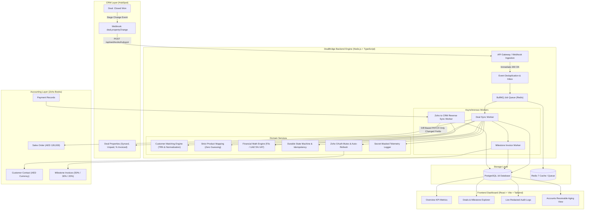

# System Architecture & Technical Specifications

## 1. Architectural Overview

DealBridge is an event-driven, bidirectional synchronization bridge linking **HubSpot CRM** and **Zoho Books ERP**. It operates on the architectural principle that **sales workflows in the CRM must never block on accounting system operations**, while maintaining ACID-compliant transactional consistency across both systems.

---

## 2. Core Architectural Pillars

### 2.1 Non-Blocking Webhook Processing
- When a sales rep moves a deal to **Closed Won** in HubSpot, the incoming webhook is validated, hashed for duplicate detection, and persisted to `webhook_events`.
- An asynchronous job is dispatched to BullMQ, and the endpoint immediately returns an HTTP `200 OK` in under **50ms**.
- If Zoho Books experiences high latency or downtime, the sales team in HubSpot experiences zero disruption.

### 2.2 Financial Minor-Unit Precision (UAE VAT 5%)
- All financial balances and calculations are executed using integer minor units (UAE fils: $1\text{ AED} = 100\text{ fils}$) using BigInt arithmetic.
- Eliminates floating-point rounding inaccuracies:
  $$\text{Deal Base: } 12,000,000\text{ fils (AED 120,000)}$$
  $$\text{VAT 5\%: } 600,000\text{ fils (AED 6,000)}$$
  $$\text{Total Sales Order: } 12,600,000\text{ fils (AED 126,000)}$$
  $$\text{M1 (50\% Signing): } 6,300,000\text{ fils (AED 63,000)}$$
  $$\text{M2 (30\% Go-Live): } 3,780,000\text{ fils (AED 37,800)}$$
  $$\text{M3 (20\% 90-Day): } 2,520,000\text{ fils (AED 25,200)}$$
  $$\text{Invariant Verified: } 63,000 + 37,800 + 25,200 = 126,000.00\text{ AED}$$

### 2.3 Durable State Machine & Idempotency
- Every operation is registered in `integration_operations` with a deterministic key:
  - Customer Sync: `deal_{deal_id}:customer_sync`
  - Sales Order: `deal_{deal_id}:sales_order`
  - Milestone Invoice: `deal_{deal_id}:invoice:milestone_{1|2|3}`
- Replaying the same webhook or restarting crashed workers re-reads the completed state and returns without duplicating documents in Zoho Books.

### 2.4 OAuth Mutex & Concurrency Locking
- The `ZohoTokenManager` maintains an asynchronous mutex lock. If an OAuth token expires, concurrent worker jobs await a single shared refresh promise, preventing duplicate token refreshes and race conditions.

### 2.5 Diff-Based CRM Property Updates
- HubSpot deal property writes are diff-checked against current values. If no values changed, the write is suppressed, conserving API quotas.
