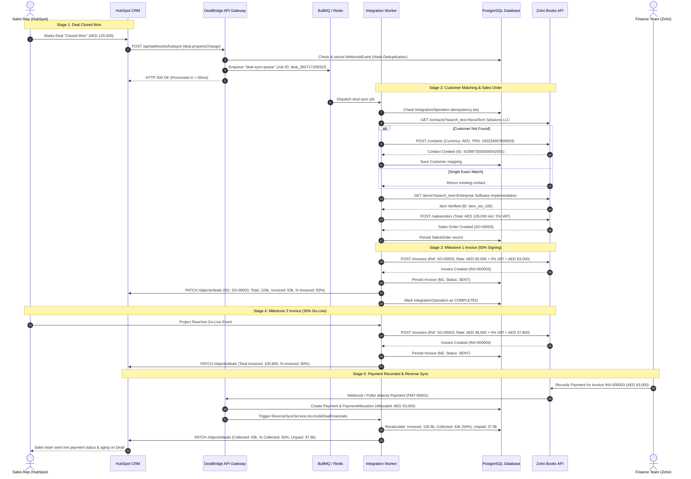

# End-to-End Sequence Diagram: Deal Closed Won to Paid

This diagram illustrates the lifecycle of the primary deal (**NovaTech Solutions LLC – Enterprise Software Implementation**) from the moment sales closes the deal to milestone billing and payment reconciliation.

